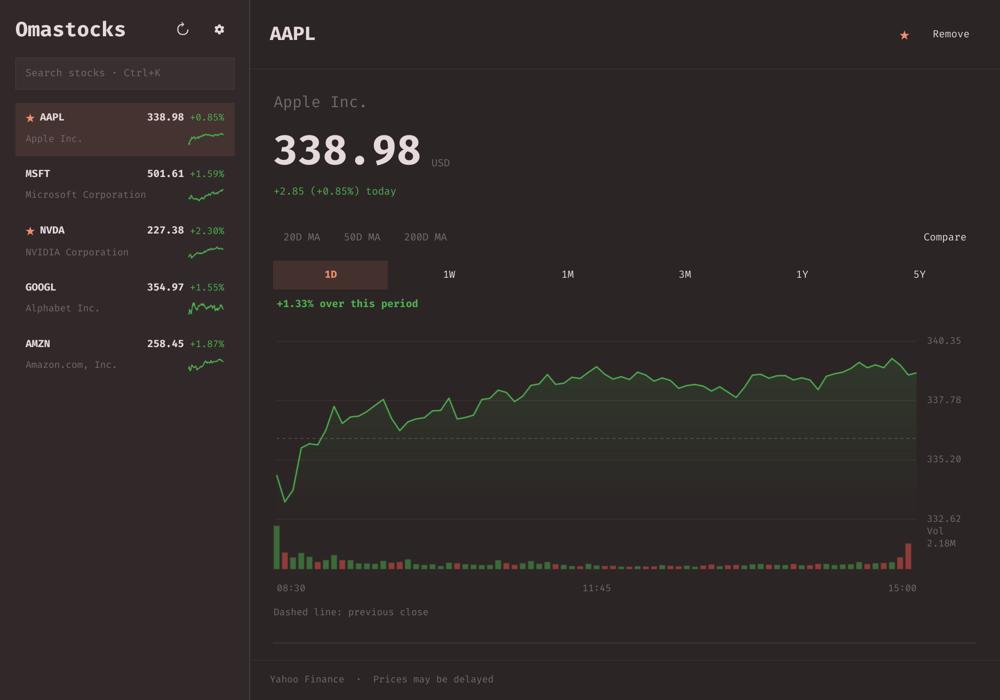
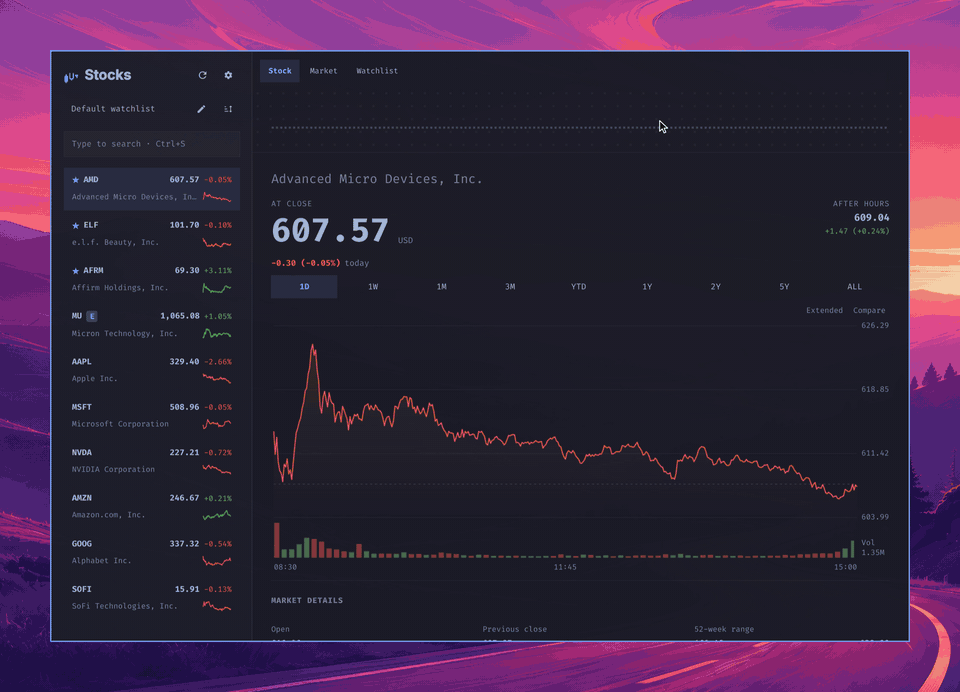
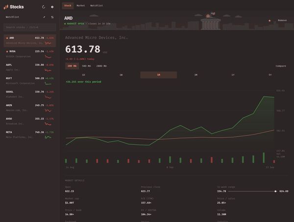
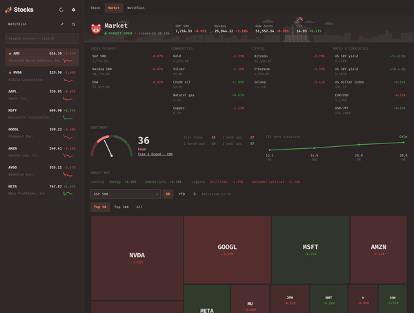
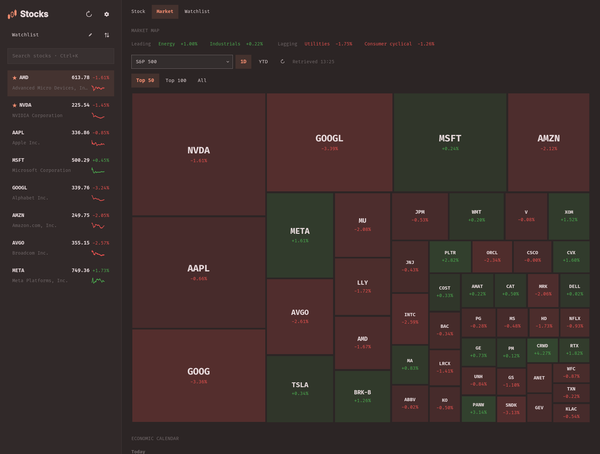
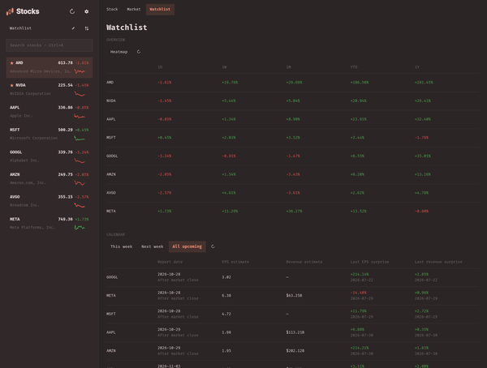
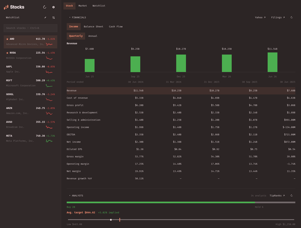
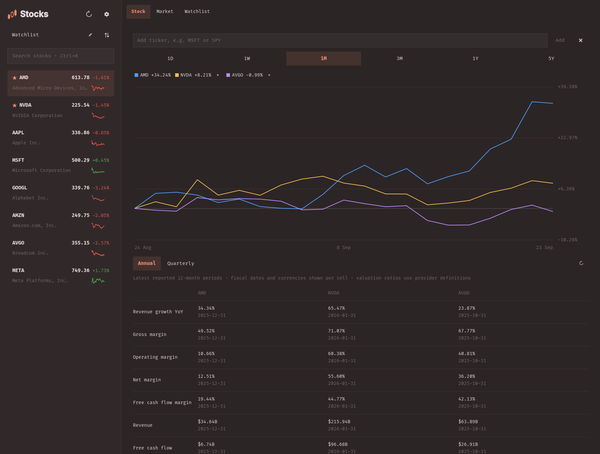

# Omastocks

A tileable stock research app for [Omarchy](https://omarchy.org), with an optional
favorites ticker in the top bar. Built with Quickshell; follows your desktop's
theme, fonts and scaling. Market data needs no API keys or Python dependencies.
Optional AI analysis uses your installed agent's existing account and model.





## Install

Requires **Omarchy's Quickshell-based shell**, Python **3.10+**, and `tzdata`.
The launcher helpers use Bash, coreutils, diffutils (`cmp`) and util-linux
(`flock`), supplied by Omarchy. Git is required by the plugin manager.

Install and enable the plugin:

```sh
omarchy plugin add https://github.com/dmitry-solomadin/omastocks --enable
```

The launcher entry and icon are installed automatically. Open the Omarchy launcher
with **Super+Space**, search for **Stocks**, and launch the app.

Installation is user-local. The window is titled **Stocks**; closing it leaves
the optional favorites ticker running.

## Explore

| View | What's inside |
|---|---|
| **Stock** | Six chart ranges, extended hours, volume, moving averages, dividends, ownership and short interest, earnings, financial statements, analyst targets, insider activity, news and social feeds. **Compare** combines charts and fundamentals for up to five symbols. |
| **Market** | Index benchmarks, futures, commodities, crypto, rates and currencies; Fear & Greed and VIX sentiment; sector/index heatmaps; US economic releases and market news. |
| **Watchlist** | Performance from 1D through 1Y, a heatmap, and an earnings calendar with EPS/revenue estimates and the latest surprises. |

### Explain latest move

Click **Explain move** at the left of the Extended/Compare row to open a popup with a concise paragraph
about the likely catalysts, market context and what to watch next. It researches
the latest quoted session (including newer pre-/post-market trading), independently
of the selected chart range. Source links appear directly after the paragraph.

In **Settings → AI**, choose **Use Omarchy default**, **Claude Code**,
**Codex**, or **OpenCode** (V2). Install and sign in to the chosen agent first and
configure its preferred model and web search. Stocks invokes that agent locally;
it does not collect subscription credentials or require its own API key. Agent
usage counts toward the account/plan configured in that agent. Other Omarchy agents
are not yet supported by the background adapters.
Sign-in/setup errors include instructions for the selected agent; complete its
sign-in in a terminal, then retry the analysis.
**Enable AI features** at the top of that tab is on by default; turning it off
hides **Explain move**, **Bull & bear** and **Market brief** and stops their requests. Saved
results are kept for when you turn it back on.

Analysis runs only when requested. Revisiting a stock shows its saved paragraph;
**Notify when ready** closes the analysis popup and sends a standard desktop
notification when research finishes, even if you switch stocks or close Stocks.
Failed research also sends a notification; cancelled research does not.
Saved research expires when exchange data shows a new regular trading session
has opened. This also resets the white AI icon; closed days retain the last result.
**Refresh** requests new research and **Cancel** stops the current job. Normal
quote/chart refreshes never generate AI requests. Earlier snapshots are labeled
after 15 minutes or a significant change in the displayed market context. A failed
refresh preserves the previous paragraph. If web research is unavailable, the panel
shows an error rather than an explanation generated from memory.

### Bull & bear case

Click **Bull & bear** in the stock's header to have the same agent research the
company and write both sides: a short summary of the debate, three to five sourced
points each for the bull and the bear case, and what to watch next. The report
opens inside Stocks, and is also saved as a self-contained HTML page: **Open in
browser** shows it there, and **Save to Downloads** saves a copy
(`AMD-bull-bear-2026-10-12.html`) to send to anyone. The page needs nothing but a
browser, follows light or dark mode, and runs no scripts.

A report is kept until you click **Refresh**; opening it again never starts new
research. It notes when it was researched and flags reports older than a week.
**Notify when ready** and **Cancel research** work as they do for Explain move.

### Market brief

Click **Market brief** in the Market view's header for the agent's take on the
day's US market: a headline, what moved stocks and why, notable movers (click one
to open it), and what to watch next. Before the open it covers the pre-market
setup; after the close, the session that just ended. Like Bull & bear, it opens
inside Stocks and is also a self-contained HTML page with the indexes, assets and
sector moves of that moment, for the browser or Downloads.

A brief belongs to its trading day. It stays until you click **Refresh**, and once
the S&P 500 trades on a later New York date, opening it researches a new one.
Weekends and holidays keep the last brief.

On IPO days, the exchange in the page header hangs a banner for each new listing.

Market maps cover the **S&P 500, Nasdaq 100, Dow Jones**, and **11 sectors**.
Choose **1D / YTD** and **Top 50 / Top 100 / All** for larger indexes. Click a
benchmark, instrument or tile to open its Stock view.

### Watchlists and controls

- Search by ticker or company name; click **+** to add a result.
- Use the list dropdown and **pen** to manage up to **12 lists, 60 stocks each**.
- **Sort Watchlist** offers Custom, Price Change, Percentage Change, Market Cap,
  Symbol and Name. Drag rows in **Custom** mode; the Overview follows the same order.
- **Star** a stock to put it in the top bar. Favorites are shared across lists;
  an overflowing ticker scrolls and pauses on hover. Hover a ticker for its day
  chart and range; click it to open that stock.
- **Settings → General** controls the topbar widget, its fields and width, the sidebar's
  displayed metric, chart volume and event markers, and lists the keyboard shortcuts.
- Hover a chart for prices; drag to measure an interval. Moving averages are
  available on **1M and longer** ranges. **Extended** adds supported pre-/post-market
  sessions to 1D. Expand a research section to load its details.
- **Last report**, earnings-call links, headlines and source buttons open in your
  browser. The Last report link resolves Google's first result for the release.

| Shortcut | Action |
|---|---|
| Letter or digit | Start a search with it, outside text fields |
| `Ctrl+S` | Focus search |
| `↑` / `↓` | Select the previous/next stock |
| `←` / `→` | Select the previous/next chart range outside text fields |
| `Enter` | Open a search result; if already in the current watchlist, clear search and highlight it there |
| `Delete` | Remove the selected stock from the watchlist |
| `Ctrl+Z` | Undo the last removal |
| `Ctrl+R` | Refresh the current view |
| `Escape` | Clear a chart selection, exit Compare, or clear search |

## Screenshots

Click a thumbnail to view the full-size screenshot.

<table>
  <tr>
    <td align="center"><a href="docs/screenshots/stock.png"></a><br><b>Stock chart</b></td>
    <td align="center"><a href="docs/screenshots/market.png"></a><br><b>Market overview</b></td>
  </tr>
  <tr>
    <td align="center"><a href="docs/screenshots/heatmap.png"></a><br><b>Market map</b></td>
    <td align="center"><a href="docs/screenshots/watchlist.png"></a><br><b>Watchlist &amp; Calendar</b></td>
  </tr>
  <tr>
    <td align="center"><a href="docs/screenshots/research.png"></a><br><b>Company research</b></td>
    <td align="center"><a href="docs/screenshots/compare.png"></a><br><b>Compare</b></td>
  </tr>
</table>

## Data and storage

Public feeds from **Yahoo Finance, Nasdaq, NYSE, TradingView, CNN, Google News,
Stocktwits and ApeWisdom** supply the data. Prices may be delayed, earnings dates
may be estimates, and coverage varies. Missing values stay **—**; failed refreshes
retain saved data. Manual refresh respects provider rate limits.

Watchlist returns exclude dividends. Market-map areas use company market cap,
not official index weights; memberships are [bundled snapshots](data/README.md).
Financials retain reporting dates and currencies. Reddit mentions measure
attention, not sentiment. Company-only panels are hidden for non-company instruments.

Watchlists and caches live in
`${XDG_STATE_HOME:-~/.local/state}/omarchy/io.github.dmitry-solomadin.omastocks/`.
Display preferences use Omarchy's plugin settings. Queries go to the relevant
provider; there is no telemetry or account setup. See
[network and cache details](docs/DEVELOPMENT.md#data-flow) for contributors.

## Update or remove

```sh
omarchy plugin update io.github.dmitry-solomadin.omastocks
omarchy plugin remove io.github.dmitry-solomadin.omastocks
```

Removal asks for confirmation. The plugin cleans up its launcher entry and icon
when unloaded; your watchlists and caches are preserved.

## Development

```text
qml/        UI, shared stores and JavaScript, organized by feature
bin/        Python data helpers and provider integrations
assets/     Launcher entry and icon
data/       Saved market memberships and their provenance
tests/      Python and JavaScript regression tests
docs/       Contributor guide and screenshot gallery
```

See the [contributor guide](docs/DEVELOPMENT.md) for setting up a development
checkout, architecture, checks and reload commands.

## License

[MIT](LICENSE). Market data and publisher images belong to their respective
providers.
